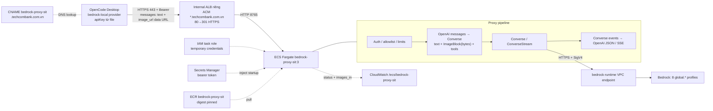

# ADR-0011: Bedrock proxy SIT — hợp đồng API, hỗ trợ ảnh và quy trình vận hành cho agent

- **Trạng thái:** Accepted (kiến trúc SIT; không phải phê duyệt production/compliance)
- **Ngày:** 2026-11-15
- **Phạm vi:** Service `bedrock-proxy-sit` phục vụ OpenCode — mở rộng [ADR-0009](0009-bedrock-proxy-sit-isolated-ecs-fargate.md); không thay đổi pipeline OCR.
- **Nguồn:** `[FROM SOURCE: AWS ECS describe-services / describe-task-definition 2026-11-15]`, `[FROM SOURCE: scripts/bedrock_http_proxy.py]`, `[FROM SOURCE: ecs-test-results.json — 29/29]`, `[FROM SOURCE: ecs-runbook.md]`, `[FROM SOURCE: image-support-plan.md]`, `[FROM SOURCE: service-workflows.md]`

> **Quan hệ với ADR khác:** Không supersede ADR-0009 — ADR-0009 giữ quyết định hạ tầng (Fargate, ALB riêng, task role). ADR này ghi các quyết định phát sinh sau đó (streaming, bỏ lock, ảnh, DNS, cấu hình client) và là **tài liệu thực thi chính cho agent**. Không miễn trừ [ADR-0004](0004-pii-masking-guardrail-residency.md).
>
> **Dành cho agent:** đọc §0 trước khi làm bất cứ việc gì; §5 là các quy trình thực thi; §6 là kiểm thử bắt buộc; §8 là việc còn mở.

---

## 0. Quy tắc bắt buộc cho agent

1. **Không sửa tài nguyên OCR Hub**: `ocr-hub-web|api|worker|beat`, `ocr-hub-sit-alb`, SG/role/secret của OCR. Proxy chỉ dùng chung cluster, VPC, subnet và certificate ACM (chỉ tham chiếu).
2. **Không tắt TLS verification** (`verify=False`, `curl -k`, `--no-verify-ssl`, `NODE_TLS_REJECT_UNAUTHORIZED=0`). Dùng CA bundle `~/.aws/cacert.pem`.
3. **Không in, log, commit** bearer token, nội dung prompt/response hay byte/base64 ảnh. Log chỉ chứa status và số đếm.
4. **Không xóa** task definition cũ hoặc image cũ trong ECR — đây là đường rollback.
5. **Chỉ test bằng dữ liệu giả** (prompt tổng hợp, ảnh màu tự sinh). Không dùng ảnh chụp màn hình thật: `global.*` có thể xử lý ngoài Singapore.
6. **Không mở rộng ingress** (SG/CIDR) khi chưa có xác nhận rõ của người dùng; mỗi rule là `/32` cụ thể.
7. SSO hết hạn (`ExpiredToken`) → **dừng, nhờ người dùng đăng nhập**; không tự xử lý MFA.
8. Workspace `/Users/thanhnh6/2ndBrain` **không phải Git repo** → sao lưu file trước khi sửa.
9. Mọi lệnh AWS: `--profile data-app-sit --region ap-southeast-1 --ca-bundle ~/.aws/cacert.pem`.
10. Gọi model phát sinh phí Bedrock — dùng `max_tokens` nhỏ khi test.

---

## 1. Bối cảnh

ADR-0009 (2026-11-06) triển khai proxy revision `:1`: SSE buffered, global lock, `read_timeout=120s`, chỉ nhận text. Sau đó:

- **2026-11-12:** corporate DNS `bedrock-proxy-sit.techcombank.com.vn` (443 + 80) được tạo. Một request đầu tiên sau ~6 ngày idle timeout 120 s; nguyên nhân chưa xác định. Revision `:2` chuyển sang ConverseStream, bỏ global lock, nâng urllib3 lên 2.8.0.
- **2026-11-13:** người dùng upload ảnh trong OpenCode nhưng model không nhận được. Phân tích hai tầng:
  1. Proxy: `_content_to_text()` bỏ im lặng phần `image_url` → Bedrock không nhận khối `image`.
  2. OpenCode: model chưa khai báo nhận ảnh → client có thể không gửi ảnh.
  Revision `:3` sửa tầng 1; cấu hình OpenCode được bổ sung cho tầng 2.

---

## 2. Trạng thái hiện tại (snapshot 2026-11-15)

| Hạng mục | Giá trị |
|---|---|
| Account / region | `211125523619` (`data-app-sit`) / `ap-southeast-1` |
| Cluster / service | `ocr-hub-sit-cluster` / `bedrock-proxy-sit`, Fargate On-Demand, **1/1 running** |
| Task definition | **`bedrock-proxy-sit:3`** |
| Image | `211125523619.dkr.ecr.ap-southeast-1.amazonaws.com/bedrock-proxy-sit@sha256:a967cdd57e152dc45f0e495923f5cc224c7c75a39ebcece968282d4aa79ae0dd` (tag `py314-20261113-v3`) |
| Runtime | Python 3.14.10, boto3/botocore 1.43.39, urllib3 2.8.0, UID 10001, 0,5 vCPU / 1 GiB |
| URL client | **`https://bedrock-proxy-sit.techcombank.com.vn/v1`** (CNAME → `internal-bedrock-proxy-sit-alb-1928164211.ap-southeast-1.elb.amazonaws.com`) |
| ALB | `bedrock-proxy-sit-alb`, internal; HTTPS 443 (ACM `*.techcombank.com.vn`), HTTP 80 → 301 HTTPS; idle timeout 900 s |
| ALB SG | `sg-00547bbdfeca0384a`: 443 + 80 từ `10.63.30.164/32` và `10.67.192.159/32` (IP VPN cá nhân) |
| Task SG | `sg-0a3eadaa24c092c1e`: 8765 chỉ từ ALB SG; outbound 443 |
| Target group | `bedrock-proxy-sit-tg`, HTTP 8765, health `GET /health` |
| IAM | Task role `bedrock-proxy-sit-task-role` (chỉ `InvokeModel*` trên 8 profile); exec role `bedrock-proxy-sit-exec-role` |
| Secret | `bedrock-proxy-sit/bearer-token` (token dùng chung) |
| Log | `/ecs/bedrock-proxy-sit`, retention 14 ngày |
| Kiểm thử | Offline OK; **live 29/29 PASS** (18 hồi quy + 8 ảnh/model + 1 ảnh stream + 2 từ chối) |
| ECR scan `:3` | Không CRITICAL; 4 HIGH glibc/zlib chưa có bản sửa (CVE-2026-19499, CVE-2026-5435, CVE-2026-76844, CVE-2026-85091) |

**Revisions:**

| Revision | Digest | Hành vi |
|---|---|---|
| `:1` | `sha256:eda00733…c8439b` | SSE buffered, global lock, read timeout 120 s, urllib3 2.7.0, text-only |
| `:2` | `sha256:c2f3d789…0bb2f8` | ConverseStream token SSE, không lock, `LLM_TIMEOUT=300`, urllib3 2.8.0, text-only (ảnh bị bỏ im lặng) |
| `:3` | `sha256:a967cdd5…79ae0dd` | `:2` + ảnh data URL, từ chối phần không hỗ trợ, body 20 MiB, log `images_in` — **đang chạy** |

> ⚠️ **Quan sát cấu hình client 2026-11-15:** `~/.config/opencode/opencode.json` provider `bedrock-local` đang trỏ **`http://127.0.0.1:8765/v1`** (proxy local), `apiKey` = `{file:~/.config/opencode/secrets/bedrock-proxy-token}`. Tức là OpenCode **chưa dùng proxy ECS** tại thời điểm kiểm tra. Agent không tự đổi; hỏi người dùng muốn dùng endpoint nào (xem §5.6).

---

## 3. Quyết định

### D1. Hợp đồng API

Proxy cung cấp endpoint OpenAI-compatible tối thiểu cho OpenCode:

| Endpoint | Auth | Mô tả |
|---|---|---|
| `GET /health`, `/healthz` | Không | Chỉ kiểm tra listener; **không** chứng minh token/credentials/model |
| `GET /v1/models` | Không | Trả 8 model trong allowlist |
| `POST /v1/chat/completions` | `Authorization: Bearer <token>` | Chat Completions → Bedrock Converse / ConverseStream |
| `POST` body kiểu draw.io (`prompt`/`user_message`) | Bearer | Đường cũ, chỉ text |

- `stream: true` → **ConverseStream relay token-by-token** (chunked SSE), gồm text delta, `reasoning_content`, `tool_calls` tăng dần, `finish_reason`, `usage`, `data: [DONE]`.
- Không stream → một `chat.completion` JSON.
- Tool calling: OpenAI `tools[]` → Converse `toolSpec`; `tool_calls`/`role: tool` ↔ `toolUse`/`toolResult`. **Tool chạy ở client (OpenCode)**, không ở proxy.
- Proxy **không lưu** hội thoại; client gửi lại lịch sử mỗi lượt.

### D2. Kiểm soát đầu vào (trả lỗi trước khi gọi Bedrock và trước header streaming)

| Điều kiện | HTTP / mã lỗi |
|---|---|
| Thiếu/sai bearer token (so sánh `hmac.compare_digest`) | `401 unauthorized` |
| Model ngoài allowlist (gồm Fable 5.1, GLM 5.3) | `403 model_not_allowed` |
| `Transfer-Encoding` trên request | `400 unsupported_transfer_encoding` |
| Body > `DRAWIO_PROXY_MAX_BODY_BYTES` (20 MiB) | `413 request_too_large` |
| JSON lỗi / không phải object | `400 bad_json` / `400 body_must_be_object` |
| `max_tokens` ngoài `[1, 131072]` | `400 max_tokens_out_of_range` |

### D3. Hỗ trợ ảnh (từ `:3`)

**Chỉ nhận ảnh nhúng dạng data URL trong message role `user`; ánh xạ sang Converse `ImageBlock` với byte gốc.**

| Quy tắc | Chi tiết |
|---|---|
| Đầu vào | Part `{"type":"image_url","image_url":{"url":...}}` hoặc `image_url` là chuỗi; `detail` bị bỏ qua |
| Nguồn | Chỉ `data:image/<subtype>;base64,<data>`. URL `http(s)://` → `400 remote_image_url_not_supported`. **Không tải URL ngoài** (chống SSRF) |
| Định dạng | `image/png`→`png`, `image/jpeg`/`image/jpg`→`jpeg`, `image/gif`→`gif`, `image/webp`→`webp` (giá trị hợp lệ của Converse `ImageBlock`). Khác → `400 unsupported_image_format` |
| Giải mã | `base64.b64decode(validate=True)`; lỗi → `400 invalid_image_data` |
| Kích thước mỗi ảnh | ≤ `DRAWIO_PROXY_MAX_IMAGE_BYTES` = **3.750.000 byte** sau giải mã → vượt: `413 image_too_large`. Nguồn: tài liệu Claude Messages trên Bedrock (3,75 MB, ≤ 8000 px/chiều). Giới hạn riêng của model OpenAI trên Bedrock `[INFERRED — chưa xác minh]`. Proxy không kiểm tra số pixel |
| Số ảnh mỗi request | ≤ `DRAWIO_PROXY_MAX_IMAGES` = **20** (chính sách proxy, không phải giới hạn AWS công bố) → `400 too_many_images` |
| Part không nhận ra (vd `input_audio`) | `400 unsupported_content_part` — **không bao giờ bỏ qua im lặng** (đây là nguyên nhân lỗi gốc) |
| Ảnh ở role `system`/`developer`/`assistant`/`tool` | `400 image_not_supported_for_role` |
| Kết quả | `{"image": {"format": fmt, "source": {"bytes": raw_bytes}}}` cùng text trong cùng message |
| Quan sát | Log hoàn tất có `images_in=<N>` cho cả JSON và stream; không log byte/base64 |

Code: `scripts/bedrock_http_proxy.py` — `ContentError`, `_decode_image_url`, `_oai_content_to_blocks`, `_text_only_content`, `_count_image_blocks`, `_oai_messages_to_converse`.

**Lưu ý body:** base64 tăng ~33% kích thước; OpenCode gửi lại toàn bộ lịch sử nên ảnh cũ cộng dồn → gặp `413 request_too_large` thì mở phiên mới. 20 MiB được chọn có tính tới task 1 GiB RAM và request song song.

### D4. Model và quyền

- 8 model: `global.openai.gpt-6-astra`, `global.anthropic.claude-opus-5-5`, `global.openai.gpt-6.1-sol`, `global.anthropic.claude-sonnet-5-5`, `global.openai.gpt-6-sol`, `global.openai.gpt-6.1-terra`, `global.anthropic.claude-haiku-5-5`, `global.openai.gpt-6-luna`.
- Cả 8 đều **PASS test ảnh** (PNG đỏ 64×64, trả lời "red").
- Allowlist ở **hai lớp**: env `DRAWIO_PROXY_ALLOWED_MODELS` (proxy, trả 403) và IAM task role ([permission-policy.json](../../aws/spt-bedrock-proxy/permission-policy.json)). Thêm/bớt model phải sửa **cả hai** và test positive/negative.
- Credentials: ECS task role qua SDK default chain (`LLM_PROFILE=""`), tự renew; không có AWS key tĩnh.

### D5. Mạng và truy cập

- Client gọi **hostname** `bedrock-proxy-sit.techcombank.com.vn` qua HTTPS để SNI khớp wildcard certificate. Không dùng IP hoặc DNS `*.elb.amazonaws.com` với HTTPS.
- HTTP/80 chỉ redirect 301 sang HTTPS; client phải cấu hình `https://` để token không đi qua HTTP.
- Ingress giới hạn theo `/32`; IP VPN đổi thì cần rule mới được người dùng xác nhận.

### D6. Cấu hình client OpenCode

```json
"bedrock-local": {
  "npm": "@ai-sdk/openai-compatible",
  "options": {
    "baseURL": "https://bedrock-proxy-sit.techcombank.com.vn/v1",
    "apiKey": "{file:~/.config/opencode/secrets/bedrock-proxy-token}"
  },
  "models": {
    "global.anthropic.claude-sonnet-5-5": {
      "name": "…",
      "tool_call": true,
      "attachment": true,
      "modalities": { "input": ["text", "image"], "output": ["text"] }
    }
  }
}
```

- `{file:...}` thay vì `{env:...}`: **OpenCode Desktop không nhận biến `export` từ terminal** (đã gây `401` ngày 2026-11-12).
- `attachment` + `modalities`: theo schema trong binary OpenCode `v2.2.5`; khai báo cả hai vì chưa xác minh trường nào bật upload trên Desktop. Chỉ khai báo cho 8 model đã PASS; **không** cho Fable/GLM.
- Đây là đoạn trích — giữ nguyên các field khác của provider/model.

---

## 4. Kiến trúc



Chi tiết hạ tầng của cả hai dịch vụ: [service-workflows.md](../service-workflows.md).

---

## 5. Quy trình thực thi

### 5.1 Kiểm tra trạng thái

```bash
aws ecs describe-services --cluster ocr-hub-sit-cluster --services bedrock-proxy-sit \
  --profile data-app-sit --region ap-southeast-1 --ca-bundle ~/.aws/cacert.pem \
  --query 'services[0].{td:taskDefinition,running:runningCount,desired:desiredCount}' --no-cli-pager

aws elbv2 describe-target-health \
  --target-group-arn arn:aws:elasticloadbalancing:ap-southeast-1:211125523619:targetgroup/bedrock-proxy-sit-tg/c497309e8b1b11da \
  --profile data-app-sit --region ap-southeast-1 --ca-bundle ~/.aws/cacert.pem \
  --query 'TargetHealthDescriptions[].TargetHealth.State' --no-cli-pager

curl --fail --cacert ~/.aws/cacert.pem https://bedrock-proxy-sit.techcombank.com.vn/health
```

### 5.2 Bật / tắt

```bash
# Bật
aws ecs update-service --cluster ocr-hub-sit-cluster --service bedrock-proxy-sit \
  --desired-count 1 --profile data-app-sit --region ap-southeast-1 --ca-bundle ~/.aws/cacert.pem --no-cli-pager
# Tắt — ALB vẫn tính phí (~0,6 USD/ngày)
aws ecs update-service --cluster ocr-hub-sit-cluster --service bedrock-proxy-sit \
  --desired-count 0 --profile data-app-sit --region ap-southeast-1 --ca-bundle ~/.aws/cacert.pem --no-cli-pager
```

### 5.3 Xem log (không chứa nội dung)

```bash
aws logs tail /ecs/bedrock-proxy-sit --since 30m --format short \
  --profile data-app-sit --region ap-southeast-1 --ca-bundle ~/.aws/cacert.pem --no-cli-pager
# Kiểm tra ảnh có tới proxy:
aws logs tail /ecs/bedrock-proxy-sit --since 15m --format short \
  --profile data-app-sit --region ap-southeast-1 --ca-bundle ~/.aws/cacert.pem --no-cli-pager | grep images_in
```

### 5.4 Thay đổi code và deploy revision mới

Quy trình đã chạy thành công cho `:2` và `:3`. Đặt `N` = revision mới, `TAG=py314-YYYYMMDD-vN`.

1. **Sao lưu** `scripts/bedrock_http_proxy.py`, `scripts/llm_client.py`, test liên quan vào `/private/var/folders/98/dmt3hp255b513gd_1vthjswj51pl8f/T/opencode/backup-vN/`.
2. **Sửa code + thêm test offline** trong `scripts/bedrock-proxy-runtime/test_proxy_offline.py`. `FakeClient` phải có `converse_raw` và `converse_stream_raw`. Chạy:
   ```bash
   cd /Users/thanhnh6/2ndBrain
   python3 scripts/bedrock-proxy-runtime/test_proxy_offline.py 2>&1 | grep -v '^\[127' | tail -8
   ```
   Fail → dừng.
3. **Nếu đổi dependency:** sửa `scripts/bedrock-proxy-runtime/requirements.lock`, tải wheel qua Nexus (`--index-url https://nexus-dev.techcombank.com.vn/repository/pypi-common-proxy/simple --cert ~/.aws/cacert.pem --only-binary=:all: --no-deps`), build runtime image mới trên SPT và cập nhật `FROM` trong `Dockerfile.proxy`. Không đổi dependency → giữ `spt-bedrock-proxy-runtime:py314-20261112`.
4. **Upload lên SPT** (`root@10.101.11.18`, key `~/.ssh/id_ed25519_uploadhtml`) vào `/data/spt-bedrock-proxy/app-vN/`: `scripts/{bedrock_http_proxy,llm_client,openssl_conf}.py`, `Dockerfile.proxy` → `Dockerfile`; test offline → `/data/spt-bedrock-proxy/test_proxy_offline_vN.py`.
5. **Build + test trong container** (không mạng):
   ```bash
   docker build --network=none -q -t spt-bedrock-proxy:$TAG /data/spt-bedrock-proxy/app-vN
   docker run --rm --network none --read-only --cap-drop ALL --security-opt no-new-privileges:true \
     --tmpfs /tmp:size=16m -e PROXY_SOURCE=/app/scripts/bedrock_http_proxy.py \
     -v /data/spt-bedrock-proxy/test_proxy_offline_vN.py:/app/test_proxy_offline.py:ro,Z \
     spt-bedrock-proxy:$TAG sh -c 'python -m pip check && python /app/test_proxy_offline.py 2>&1 | tail -4'
   docker save -o /data/spt-bedrock-proxy/bedrock-proxy-sit-image-vN.tar spt-bedrock-proxy:$TAG
   ```
6. **Tải tar về máy local**, rồi **publish ECR**:
   ```bash
   python3 scripts/bedrock-proxy-runtime/publish_ecr.py <tar> --tag "$TAG"
   ```
   Lấy digest từ dòng `IMAGE: …@sha256:…`. **Không** `docker push` lên registry nội bộ (bị từ chối) và không dùng Docker Registry HTTP (đã gặp 503); script dùng ECR API ký SigV4. Chạy nền, timeout ≥ 10 phút.
7. **Kiểm tra ECR scan**: CRITICAL mới hoặc HIGH mới so với revision hiện tại → dừng, báo người dùng.
8. **Đăng ký task definition mới** bằng cách sao chép revision đang chạy (giữ role, secret, port, CPU/RAM, env), chỉ đổi `image` (theo digest) và env cần thiết. Xem mẫu Python tại [image-support-plan.md §4.3](../../aws/spt-bedrock-proxy/image-support-plan.md).
9. **Deploy**: `aws ecs update-service … --task-definition bedrock-proxy-sit:N` rồi `aws ecs wait services-stable` (chạy nền).
10. **Kiểm tra** §5.1 và trạng thái OCR (`ocr-hub-web`, `ocr-hub-api` không đổi), rồi chạy §6.
11. **Cập nhật tài liệu**: bảng revision trong [ecs-runbook.md](../../aws/spt-bedrock-proxy/ecs-runbook.md), [service-workflows.md](../service-workflows.md), §2 của ADR này chỉ cập nhật bằng ADR mới nếu quyết định thay đổi.

### 5.5 Rollback

```bash
aws ecs update-service --cluster ocr-hub-sit-cluster --service bedrock-proxy-sit \
  --task-definition bedrock-proxy-sit:2 \
  --profile data-app-sit --region ap-southeast-1 --ca-bundle ~/.aws/cacert.pem --no-cli-pager
```

`:2` mất hỗ trợ ảnh (ảnh bị bỏ im lặng). `:1` là fallback xa hơn.

### 5.6 Cấu hình máy người dùng (OpenCode Desktop)

1. Kiểm tra mạng: `dig bedrock-proxy-sit.techcombank.com.vn` và `curl --fail --cacert ~/.aws/cacert.pem https://…/health`. Timeout → IP nguồn chưa có trong ALB SG (xem D5).
2. Tạo file token (quyền 600, không in nội dung, không ghi đè file có sẵn) — script đầy đủ trong [service-workflows.md](../service-workflows.md) mục "Cấu hình OpenCode Desktop".
3. Sao lưu `~/.config/opencode/opencode.json`; sửa provider `bedrock-local` theo D6; kiểm tra `python3 -m json.tool … >/dev/null`.
4. `/reload` trong OpenCode; test prompt text, tool call và **ảnh giả lập**, đối chiếu `images_in` trong log (§5.3).

| Triệu chứng | Nguyên nhân thường gặp |
|---|---|
| `401` | Token chưa tới tiến trình Desktop (`export` không truyền), file token sai/cũ sau rotate, hoặc provider không trỏ URL AWS |
| `403 model_not_allowed` | Chọn Fable/GLM hoặc model ngoài allowlist |
| Timeout kết nối | IP VPN không có trong ALB SG / routing |
| Lỗi certificate | Chưa trust CA nội bộ; không tắt TLS |
| Có request, `images_in=0` | OpenCode không gửi ảnh → kiểm tra `attachment`/`modalities` của model đang chọn |
| `413 request_too_large` | Lịch sử chứa nhiều ảnh → mở phiên mới |
| `413 image_too_large` | Ảnh > 3,75 MB sau giải mã → thu nhỏ |
| `400 unsupported_content_part` | Client gửi loại nội dung proxy chưa hỗ trợ (audio, file, PDF…) |

### 5.7 Rotate bearer token

1. Cập nhật secret `bedrock-proxy-sit/bearer-token` (giá trị ngẫu nhiên mạnh).
2. `aws ecs update-service … --force-new-deployment` — task cũ không tự nạp secret mới.
3. Thông báo người dùng cập nhật file token local. Không gửi token qua chat.

---

## 6. Kiểm thử bắt buộc

| Loại | Lệnh | Tiêu chí |
|---|---|---|
| Offline | `python3 scripts/bedrock-proxy-runtime/test_proxy_offline.py` | Tất cả OK (local và trong container) |
| Live | `python3 scripts/bedrock-proxy-runtime/test_ecs_live.py` | **29/29 PASS** với `:3`; kết quả ghi vào [ecs-test-results.json](../../aws/spt-bedrock-proxy/ecs-test-results.json) |

Live bao gồm: health, thiếu token → 401, liệt kê 8 model, Fable/GLM → 403, invoke 8 model, token streaming (nhiều chunk + chunked), tool call, tool result round trip, streaming tool call, 2 request song song (không serialize), ảnh cho 8 model, ảnh + stream, URL ngoài → 400, base64 lỗi → 400.

Thêm model hoặc thay đổi chuyển đổi nội dung → bổ sung cả test positive và negative tương ứng.

---

## 7. Phương án đã cân nhắc

| Phương án | Ưu | Nhược | Kết luận |
|---|---|---|---|
| **Proxy tự chuyển OpenAI → Converse, ảnh data URL → ImageBlock** | Kiểm soát allowlist/limit/log; task role; không lưu hội thoại; đã test 29/29 | Tự bảo trì adapter, patch image | **Chọn** |
| Proxy tải ảnh từ URL ngoài | Tương thích client gửi URL | Rủi ro SSRF, egress không kiểm soát | Loại |
| Bỏ qua part không hỗ trợ | Không làm gãy client | Mất dữ liệu im lặng — chính là lỗi gốc | Loại; trả 400 |
| Client gọi thẳng `bedrock-runtime` `/openai/v1` | Bỏ adapter | OpenCode cần AWS credentials/API key; mất allowlist, limit tập trung | Chưa chọn; đáng khảo sát nếu muốn giảm code adapter |
| Amazon Bedrock Mantle | Responses API, background, server-side tools, Projects | Chưa xác nhận có ở `ap-southeast-1`; cần `bedrock-mantle:CreateInference`; không có Guardrails/cross-region profile; `store=true` mặc định lưu 30 ngày | Chỉ khi cần tính năng Mantle-only |
| Tăng body limit cao hơn | Ít `413` | Rủi ro bộ nhớ task 1 GiB khi song song | Giữ 20 MiB |

---

## 8. Hệ quả, rủi ro và việc còn mở

**Tích cực:** streaming thật, tool calling và ảnh hoạt động cho cả 8 model; lỗi đầu vào rõ ràng thay vì mất dữ liệu im lặng; có số đếm `images_in` để chẩn đoán client.

**Rủi ro / việc còn mở:**

1. **Chưa test phiên OpenCode Desktop thật end-to-end** (text + tool + ảnh). Cấu hình global hiện trỏ proxy local (§2).
2. **Residency/PII (ADR-0004):** `global.*` có thể xử lý ngoài Singapore; chưa có PII masking hay Guardrails. **Ảnh chụp màn hình dễ chứa dữ liệu nội bộ/PII** — chỉ dùng dữ liệu giả cho tới khi được phê duyệt.
3. **Token dùng chung:** chưa có định danh, quota, rate limit hay cost theo user (ADR-0008). Hướng đề xuất: API key riêng/SSO + usage ledger (`user_id`, model, token, không lưu nội dung).
4. **Timeout 120 s ngày 2026-11-12:** chưa có RCA; đề xuất thêm phase timing và request ID vào log.
5. **ECR:** 4 HIGH glibc/zlib chưa có bản sửa — theo dõi base image.
6. **Giới hạn ảnh** của model OpenAI trên Bedrock chưa xác minh; pixel không được proxy kiểm tra.
7. **Chưa hỗ trợ:** ảnh trong `toolResult`, PDF/document, audio, URL ảnh ngoài.
8. **Ingress `/32` VPN cá nhân** dễ đổi; cần dải mạng của nhóm nếu mở rộng người dùng.
9. **Single task:** không HA; deploy có downtime ngắn.
10. **Inventory lệch:** [ecs-resources.json](../../aws/spt-bedrock-proxy/ecs-resources.json) vẫn ghi image/task definition `:1` — dùng §2 hoặc `describe-services` làm nguồn đúng.

## 9. Điều kiện xem xét lại

- Production hoặc dữ liệu thật → review ADR-0004 (masking, Guardrails, residency, backend TLS).
- Nhiều người dùng → identity-aware auth, quota, cost attribution theo user.
- Cần PDF/audio/ảnh trong tool result → mở rộng D3 kèm test.
- AWS thay đổi giới hạn ảnh hoặc model hỗ trợ → cập nhật hằng số và allowlist.
- Cần HA/concurrency cao → ≥ 2 task, xem lại body limit và bộ nhớ.

## 10. Tham chiếu

- [ADR-0009 — hạ tầng proxy SIT](0009-bedrock-proxy-sit-isolated-ecs-fargate.md) · [ADR-0004](0004-pii-masking-guardrail-residency.md) · [ADR-0008](0008-observability-cost-attribution.md)
- [service-workflows.md](../service-workflows.md) — sơ đồ, cấu hình OpenCode, hỗ trợ ảnh
- [ecs-runbook.md](../../aws/spt-bedrock-proxy/ecs-runbook.md) · [image-support-plan.md](../../aws/spt-bedrock-proxy/image-support-plan.md) · [ecs-test-results.json](../../aws/spt-bedrock-proxy/ecs-test-results.json) · [permission-policy.json](../../aws/spt-bedrock-proxy/permission-policy.json)
- [Điều tra timeout 2026-11-12](../bedrock-proxy-sit-timeout-investigation-20261112.md)
- Code: `scripts/bedrock_http_proxy.py`, `scripts/llm_client.py`, `scripts/bedrock-proxy-runtime/`
- AWS: [Converse ImageBlock](https://docs.aws.amazon.com/bedrock/latest/APIReference/API_runtime_ImageBlock.html) · [Inference endpoints](https://docs.aws.amazon.com/bedrock/latest/userguide/endpoints.html)

Không đưa token, SSO cache, private key hay nội dung ảnh vào ADR.
