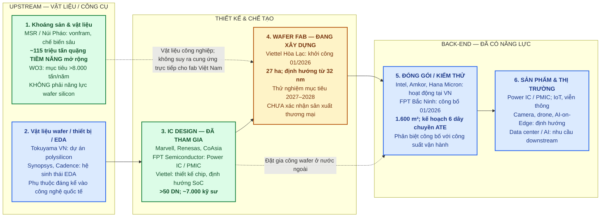
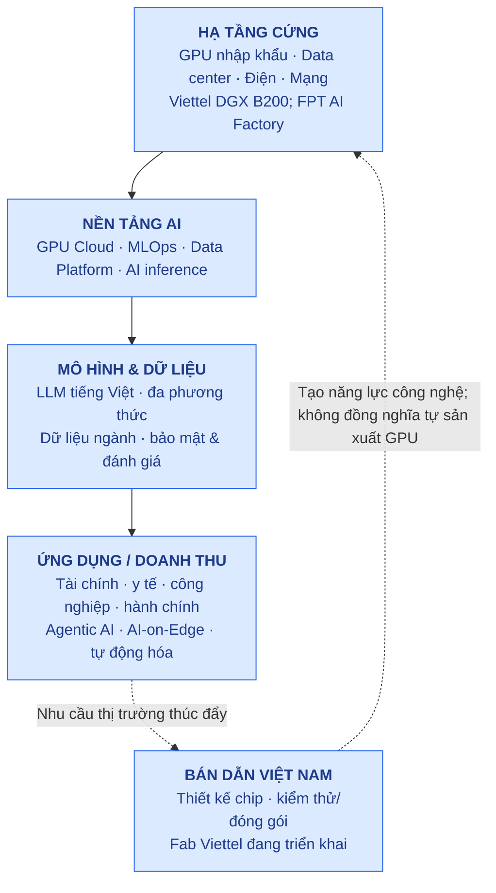

# Việt Nam – Cơ hội phát triển AI & chuỗi giá trị bán dẫn

> **Cập nhật nghiên cứu:** 24/10/2026. Phân biệt **đã vận hành**, **đã công bố/đang triển khai**, **mục tiêu** và **chưa chứng minh**. Đây là nghiên cứu ngành, không phải khuyến nghị mua bán cổ phiếu.

## 1. Luận điểm chính

Việt Nam có cơ hội tham gia sâu hơn chuỗi giá trị **AI × bán dẫn** qua ba nhóm: (1) vật liệu chiến lược và chuỗi cung ứng; (2) thiết kế, kiểm thử/đóng gói chip; (3) hạ tầng tính toán AI, dữ liệu, mô hình và ứng dụng. Không nên đồng nhất **một dự án khởi công** với **năng lực sản xuất thương mại**, hay **sở hữu mỏ vonfram** với **sản xuất wafer silicon**.

Theo tổng hợp công bố năm 2026, Việt Nam có **hơn 50 doanh nghiệp thiết kế chip**, khoảng **7.000 kỹ sư thiết kế**, **241 dự án FDI bán dẫn** với tổng vốn **trên 14,2 tỷ USD**. Các chỉ tiêu này khác phạm vi, không cộng với nhau. Nguồn: [Nhân Dân, 2026](https://nhandan.vn/viet-nam-dan-hoan-thien-cac-manh-ghep-trong-chuoi-gia-tri-ban-dan-post983008.html).

## 2. SƠ ĐỒ CHUỖI GIÁ TRỊ BÁN DẪN – VỊ TRÍ VIỆT NAM (10/2026)

**Đọc sơ đồ:** xanh lá = có năng lực hiện hữu ở công đoạn mô tả; vàng = dự án/chưa vận hành thương mại; xanh dương = kết hợp hoạt động hiện hữu và kế hoạch. Mũi tên là **logic công nghệ**, không phải bằng chứng giao dịch thương mại giữa các công ty.

## 3. Bản đồ doanh nghiệp / công đoạn / bằng chứng

| Mắt xích | Doanh nghiệp / hiện trạng Việt Nam | Mức xác nhận đến 10/2026 | Điểm cần theo dõi |
|---|---|---|---|
| Vonfram và vật liệu công nghiệp | **MSR (UPCoM)**: Núi Pháo, Masan Tungsten Chemicals; khai thác, chế biến sâu vonfram | **Đang hoạt động**; 115 triệu tấn là **tiềm năng tài nguyên mở rộng**, chưa phải trữ lượng khai thác đã xác minh hoặc sản lượng; WO₃ >8.000 tấn là **mục tiêu công suất** | Giấy phép, trữ lượng chuẩn, capex, sản lượng WO₃, tỷ trọng sản phẩm công nghệ cao, hợp đồng khách hàng bán dẫn thực tế |
| Polysilicon / wafer materials | Tokuyama Việt Nam: dự án liên quan polysilicon, vốn >60 triệu USD được báo cáo | **Dự án**, không khẳng định Việt Nam đã có chuỗi silicon wafer hoàn chỉnh | Vận hành thương mại, chất lượng vật liệu, đầu ra |
| Thiết kế IC | **FPT**: Power IC/PMIC, thiết kế theo yêu cầu; **Viettel**: chip chuyên dụng; **Marvell, Renesas, CoAsia**: hoạt động thiết kế tại VN | **Có hoạt động thực tế**; mức sở hữu IP và doanh thu riêng từng pháp nhân cần kiểm chứng | Tape-out, chip bán ra, IP sở hữu, thiết kế SoC AI-on-Edge |
| Chế tạo wafer | **Viettel**: dự án nhà máy 27 ha Hòa Lạc, khởi công 16/01/2026, hướng tới tiến trình từ 32 nm | **Đang xây dựng**; kế hoạch sản xuất thử trong giai đoạn 2027–2028, **chưa xác nhận fab thương mại** | Lắp đặt thiết bị, wafer starts/month, yield, node thực tế, khách hàng |
| Đóng gói & kiểm thử (OSAT) | **Intel, Amkor, Hana Micron**: năng lực hiện hữu tại Việt Nam | **Đã có hoạt động** | Sản lượng, công suất, advanced packaging, nội địa hóa |
| OSAT do DN Việt làm chủ | **FPT**: công bố nhà máy Bắc Ninh 28/01/2026, giai đoạn 2026–27: 1.600 m², 6 dây chuyền kiểm tra chức năng | **Công bố/triển khai**; không coi công suất kế hoạch là sản lượng thực tế | Ngày vận hành, utilization, khách hàng, doanh thu OSAT |
| AI compute | **Viettel AI**: DGX B200 tại Hòa Lạc, công bố vận hành 02/2026, hiệu năng quảng bố 1,5 EFLOPS FP8; **FPT AI Factory**: H100/H200, công bố bổ sung B300 | Viettel B200 **vận hành**; FPT AI Factory **cung cấp dịch vụ**, B300 là **công bố triển khai** | GPU giờ sử dụng, công suất điện, doanh thu cloud AI, capex |
| AI software / ứng dụng | FPT, Viettel và hệ sinh thái DN Việt phát triển mô hình tiếng Việt, ứng dụng doanh nghiệp | **Đã có hoạt động**, nhưng không đồng nhất với tự chủ toàn bộ chip/GPU | Doanh thu AI thuần, năng suất khách hàng, số mô hình đưa vào production |

### Các lưu ý xác thực quan trọng

- **MSR → AI/bán dẫn:** vonfram có ứng dụng trong vật liệu/thiết bị công nghệ cao, nhưng chưa có bằng chứng trong nguồn này về tỷ trọng doanh thu MSR đến trực tiếp từ **nhà sản xuất chip AI**. Không gán doanh thu AI khi chưa có công bố.
- **FPT và Viettel khác vai trò:** FPT có thiết kế chip và đang xây dựng năng lực kiểm thử/đóng gói; Viettel có thiết kế chip và đang triển khai **fab wafer**. Cả hai hợp tác phát triển SoC AI-on-Edge 28–32 nm, đây là **định hướng hợp tác**, không phải sản lượng chip đã giao.
- **Intel/Amkor/Hana Micron:** nhà máy ở Việt Nam là năng lực công nghiệp **FDI tại Việt Nam**, không phải toàn bộ giá trị gia tăng hay IP do doanh nghiệp Việt sở hữu.
- **>50 doanh nghiệp, 7.000 kỹ sư, 14,2 tỷ USD/241 dự án:** số liệu toàn ngành từ báo chí dẫn cơ quan điều phối; không suy diễn thành doanh thu ngành hay tổng vốn đã giải ngân.

## 4. SƠ ĐỒ CƠ HỘI AI – TỪ CHIP ĐẾN ỨNG DỤNG

### Mục tiêu chính sách AI 2030 — **không phải số liệu hiện trạng**

Theo Quyết định 1671/QĐ-TTg ngày 28/08/2026, mục tiêu: kinh tế AI ~**6% GDP**, xuất khẩu sản phẩm/dịch vụ/giải pháp AI ~**5 tỷ USD**, **10.000** nhân lực AI trình độ cao, **50.000** nhân lực trình độ đại học có năng lực ứng dụng AI, đầu tư AI **1–1,5% GDP/năm**, năng lực tính toán khoảng **560 EFLOPS BF16 hoặc 1.100 EFLOPS FP8** và công suất điện khoảng **500 MW**. Đây là **target 2030**, không phải năng lực đã đạt. [Bộ KH&CN, 28/08/2026](https://mst.gov.vn/viet-nam-dat-muc-tieu-den-nam-2030-kinh-te-ai-dat-6-gdp-197260828222657306.htm).

## 5. Góc nhìn đầu tư / CherryStock watchlist

| Nhóm cơ hội | Ví dụ | Luận điểm cần kiểm chứng | Rủi ro |
|---|---|---|---|
| Vật liệu chiến lược | **MSR** (niêm yết UPCoM); liên hệ tập đoàn mẹ cần phân tích riêng | Nâng tỷ lệ chế biến sâu, xuất khẩu vật liệu chất lượng cao | Giá vonfram, giấy phép, capex, chưa chứng minh doanh thu chip AI |
| Thiết kế chip + AI cloud | **FPT** (HOSE) | Dịch vụ AI, thiết kế PMIC/SoC, đóng gói kiểm thử | Biên lợi nhuận, chi phí GPU, thương mại hóa sản phẩm |
| Viễn thông / hạ tầng AI | **Viettel** (không niêm yết trực tiếp như cổ phiếu tập đoàn) | Hạ tầng tính toán, fab và thiết kế chip | Không có mã cổ phiếu tập đoàn để đầu tư trực tiếp; không tự động gán tác động cho công ty con niêm yết |
| Hạ tầng hỗ trợ | Điện, data center, khu công nghiệp, đào tạo | Nhu cầu thuê hạ tầng, điện, kỹ sư | Dự án công bố không đồng nghĩa dòng tiền hiện hữu |

**Backlog dữ liệu đề xuất:** `dim_Semiconductor_Value_Chain` (stage, technology, status), `dim_VN_AI_Semiconductor_Company` (ticker, legal_entity, domestic_vs_FDI), `fact_VN_Semiconductor_Project` (capex, capacity, start_date, operational_date, evidence_url, evidence_status), `fact_VN_AI_Compute_Capacity` (GPU, FLOPS, power_MW, commissioned), `fact_VN_Semiconductor_KPI` (engineers, exports, tapeouts, revenue). UI: **value-chain map + maturity heatmap + project milestones + watchlist**. Dữ liệu cần theo ngày xác minh, không suy đoán sản lượng.

## 6. Nguồn kiểm chứng (truy cập 24/10/2026)

1. [Nhân Dân — Việt Nam dần hoàn thiện các mảnh ghép trong chuỗi giá trị bán dẫn](https://nhandan.vn/viet-nam-dan-hoan-thien-cac-manh-ghep-trong-chuoi-gia-tri-ban-dan-post983008.html).
2. [Masan — MSR Núi Pháo: tiềm năng mở rộng 115 triệu tấn và mục tiêu WO₃ >8.000 tấn](https://www.masangroup.com/news/press-releases/msr-strengthens-its-global-strategic-materials-platform-adding-a-potential-115-million-tons-of-tungsten-polymetallic-resources-and-expanding-tungsten-oxide-capacity-to-more-than-8000-tonnes-wo/).
3. [FPT — Công bố nhà máy đóng gói và kiểm thử, 28/01/2026](https://fpt.com/vi/tin-tuc/fpt-cong-bo-thanh-lap-nha-may-kiem-thu-va-dong-goi-tien-tien-chip-ban-dan).
4. [Bộ Xây dựng — Khởi công fab Viettel](https://www.moc.gov.vn/vn/tin-tuc/1305/91196/khoi-cong-xay-dung-nha-may-che-tao-chip-ban-dan-cong-nghe-cao-dau-tien-cua-viet-nam.aspx).
5. [Báo Chính phủ — Viettel vận hành DGX B200](https://baochinhphu.vn/viettel-van-hanh-he-thong-sieu-may-tinh-cua-nvidia-dau-tien-tai-viet-nam-10226020615345696.htm).
6. [FPT — AI Factory mở rộng HGX B300, 25/03/2026](https://fpt.com/vi/tin-tuc/fpt-trien-khai-ha-tang-ai-voi-nvidia-gpu-the-he-moi-phat-trien-ai-suy-luan).
7. [Bộ KH&CN — Chiến lược AI quốc gia 2030](https://mst.gov.vn/viet-nam-dat-muc-tieu-den-nam-2030-kinh-te-ai-dat-6-gdp-197260828222657306.htm).
8. [Vietnam Innovators Digest — EP109, Lê Quang Đạm](https://www.youtube.com/watch?v=eErmjM2Vxgs). Quan điểm thị trường ngách là ý kiến khách mời, không phải chứng minh thực nghiệm về lợi thế từng doanh nghiệp.
