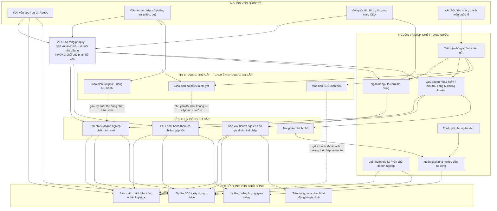

# Bản đồ dòng vốn Việt Nam: quốc tế → trung gian tài chính → nền kinh tế → thị trường tài sản

**Ngày lập:** 2026-10-24 · **Loại:** Khung nghiên cứu kinh tế vĩ mô / capital flow mapping · **Trạng thái:** Mô hình khái niệm, **không phải thống kê tỷ trọng vốn thực tế**.

## 1. Nguyên tắc đọc sơ đồ

- **VIFC (Vietnam International Financial Centre)** được nghiên cứu như **hạ tầng pháp lý, dịch vụ, sản phẩm và kết nối huy động vốn quốc tế**, không phải một quỹ ngân sách hay một tổ chức tự động cấp phát vốn. Không được cộng VIFC như một nguồn vốn độc lập bên cạnh FDI/FII/vay nợ, vì sẽ **đếm trùng**.
- Phân biệt **dòng vốn sơ cấp** (doanh nghiệp/chính phủ thực nhận khi phát hành, vay hoặc nhận đầu tư), **giao dịch thứ cấp** (tiền đổi chủ giữa nhà đầu tư), **tín dụng** (ngân hàng tạo khoản vay kèm nghĩa vụ nợ), và **chi tiêu ngân sách**.
- Dòng vốn xuyên biên giới có **chiều vào và chiều ra**; lợi nhuận, cổ tức, lãi vay, trả nợ gốc và thoái vốn làm thay đổi dòng ròng. Tiền có thể chuyển qua ngân hàng hoặc hạ tầng tài chính mà không tạo thêm vốn thực.
- BĐS, cổ phiếu, trái phiếu là **tài sản/kênh huy động và giao dịch**; doanh nghiệp sản xuất, hộ gia đình, dự án hạ tầng là **bên sử dụng vốn cuối cùng**. Không cộng toàn bộ giá trị giao dịch chứng khoán/BĐS vào vốn đầu tư thực.
- Sơ đồ dưới đây là **mối quan hệ**, độ rộng mũi tên **không biểu thị tỷ trọng**. Để tính tỷ trọng phải xác định kỳ, mẫu số và dữ liệu thực.

## 2. Sơ đồ tổng thể: nguồn → kênh → nơi sử dụng vốn

**Lưu ý kỹ thuật:** Mũi tên từ giao dịch thứ cấp về kênh sơ cấp là **tác động gián tiếp thông qua giá, định giá, thanh khoản**, không phải dòng tiền tự động chảy vào doanh nghiệp. Một số dòng vốn quốc tế có thể đi thẳng tới doanh nghiệp, không bắt buộc qua VIFC. Các mũi tên vào VIFC chỉ biểu thị **kênh có thể được hỗ trợ**, không hàm ý tất cả FDI/FII/ODA thực tế phải đi qua trung tâm này.

## 2A. Hiện trạng định lượng theo từng box — chốt dữ liệu đến 30/09/2026 (nguồn công bố đến 24/10/2026)

**Quy ước:** `FLOW` = phát sinh trong 9 tháng; `STOCK` = số dư tại một ngày; `MARKET_VALUE` = giá trị định giá; `TURNOVER` = doanh số giao dịch; `REGISTERED` = đăng ký, chưa phải giải ngân; `PROXY` = đại diện không trùng hoàn toàn với box. Đơn vị giữ nguyên như nguồn. `N/A` nghĩa là chưa tìm được dữ liệu quốc gia đủ tin cậy/cùng phạm vi, **không phải 0**.

### A. Nguồn vốn quốc tế

| Box trong sơ đồ | Số liệu mới nhất và kỳ | Phân loại / mức độ phù hợp | Nguồn |
|---|---|---|---|
| FDI | **21,07 tỷ USD thực hiện 9T/2026** (+12,1% YoY); **50,36 tỷ USD đăng ký** (+76,4% YoY): cấp mới 29,24; điều chỉnh 14,15; góp vốn/mua cổ phần 6,97 tỷ USD | FLOW thực hiện vs REGISTERED; **không cộng hai số** | [Cục Thống kê, 03/10/2026](https://www.nso.gov.vn/du-lieu-va-so-lieu-thong-ke/2026/10/thong-cao-bao-chi-tinh-hinh-kinh-te-xa-hoi-quy-iii-va-9-thang-nam-2026/) |
| FII | Khối ngoại **bán ròng khoảng 4.775–4.830 tỷ đồng trên HOSE trong tháng 9/2026** (hai nguồn/phương pháp); chưa có tổng FII xuyên biên giới 9T bao gồm cổ phiếu, trái phiếu, sơ cấp và thứ cấp | PROXY **giao dịch cổ phiếu HOSE**, không phải tổng FII/BOP | [HOSE qua FNS](https://funan.com.vn/vi/thanh-khoan-hose-sut-giam-khoi-ngoai-ban-rong-hon-47-ngan-ty-dong-trong-thang-9.1500131), [VnEconomy](https://vneconomy.vn/dong-von-ngoai-kho-dao-chieu-trong-ngan-han-do-lai-suat-toan-cau-duy-tri-cao-lau-hon.htm) |
| Vay quốc tế / tài trợ thương mại / ODA | **N/A** cho tổng giải ngân ròng 9T/2026 trên cùng phạm vi; vốn nước ngoài trong kế hoạch đầu tư công trung ương được giao **17.664,1 tỷ đồng** là **kế hoạch**, không phải vay nước ngoài thực nhận | MISSING / PLAN, không cộng vào FDI | [Bộ Tài chính, báo cáo 818/BC-BTC](https://baochinhphu.vn/giai-ngan-von-dau-tu-cong-9-thang-nam-2026-mot-so-bo-nganh-dia-phuong-con-cham-102261003011740764.htm) |
| Kiều hối | **Gần 6,9 tỷ USD về TP.HCM trong 9T/2026**, giảm 13,8% YoY; quý III hơn 2,83 tỷ USD | FLOW **chỉ TP.HCM**, không phải toàn quốc; không suy rộng | [NHNN Khu vực 2, 19/10/2026](https://tphcm.baochinhphu.vn/kieu-hoi-chuyen-ve-tphcm-dat-gan-69-ty-usd-101261019212322544.htm) |
| VIFC | Chưa có số vốn huy động/giải ngân thực tế được kiểm chứng và tách biệt đến Q3/2026 | **ENABLER, KHÔNG PHẢI SOURCE**; theo dõi sản phẩm, tổ chức, phát hành thực qua IFC khi có | [Video thảo luận VIFC](https://www.youtube.com/watch?v=_egJXqDKL-U) — nguồn ý tưởng, không phải số liệu chính thức |

**Phân bổ FDI đăng ký cấp mới theo ngành:** chế biến chế tạo **13,38 tỷ USD (45,8%)**, vận tải kho bãi **5,14 tỷ USD (17,6%)**; đây là cơ cấu **vốn đăng ký mới**, **không phải cơ cấu giải ngân FDI**. [Nguồn Cục Thống kê qua Báo Chính phủ](https://baochinhphu.vn/von-fdi-thuc-hien-9-thang-dat-hon-21-ti-usd-cao-nhat-cung-ky-5-nam-qua-102261003103902217.htm).

### B. Nguồn và định chế trong nước

| Box | Số liệu / kỳ | Loại và cảnh báo | Nguồn |
|---|---|---|---|
| Tiết kiệm hộ gia đình / tiền gửi | **Huy động vốn TCTD tăng 9,78%** đến 28/9/2026 so với cuối năm trước; **không có số dư tiền gửi hộ gia đình riêng** trong nguồn đã tra | Tăng trưởng, không phải số tiền tuyệt đối; huy động TCTD ≠ riêng tiết kiệm dân cư | [Cục Thống kê](https://www.nso.gov.vn/du-lieu-va-so-lieu-thong-ke/2026/10/thong-cao-bao-chi-tinh-hinh-kinh-te-xa-hoi-quy-iii-va-9-thang-nam-2026/) |
| Lợi nhuận giữ lại / vốn chủ doanh nghiệp | **N/A** tổng quốc gia 9T/2026; cần dữ liệu BCTC theo doanh nghiệp, vốn chủ và dòng tiền tự tài trợ | MISSING, không lấy vốn hóa làm vốn chủ |
| Thuế/phí/thu NSNN | **Tổng thu NSNN 2.187,3 nghìn tỷ đồng 9T/2026** (+12,1% YoY); thu nội địa **1.880,3 nghìn tỷ** | FLOW; thu nội địa không đồng nghĩa toàn bộ thuế TNDN | [Cục Thống kê](https://www.nso.gov.vn/du-lieu-va-so-lieu-thong-ke/2026/10/thong-cao-bao-chi-tinh-hinh-kinh-te-xa-hoi-quy-iii-va-9-thang-nam-2026/) |
| Ngân hàng/TCTD | **Dư nợ tín dụng 20,75 triệu tỷ đồng ngày 30/9/2026**, +11,59% từ đầu năm, +16,69% YoY (nguồn NHNN qua Bảo hiểm tiền gửi VN) | STOCK; **có nguồn báo Chính phủ ghi 27,5 triệu tỷ đồng trong thân bài nhưng tiêu đề 20,75**, cần đối soát trước ETL | [Bảo hiểm tiền gửi VN dẫn NHNN](https://www.div.gov.vn/ngan-hang-nha-nuoc-hop-bao-ve-ket-qua-dieu-hanh-chinh-sach-tien-te-va-hoat-dong-ngan-hang-9-thang-thuc-day-ngan-hang-so-bao-dam-quyen-loi-hop-phap-cua-nguoi-gui-tien), [bản có mâu thuẫn](https://cms.baochinhphu.vn/nhnn-toc-do-tang-lai-suat-dang-cham-lai-102261007182510571.htm) |
| Quỹ / bảo hiểm / chứng khoán | **AUM ngành quản lý quỹ hơn 834 nghìn tỷ đồng tại 30/6/2026**, NAV quỹ đầu tư trên **93 nghìn tỷ**; phí bảo hiểm **175,8 nghìn tỷ đồng 9T/2026** | AUM/NAV = STOCK, phí bảo hiểm = FLOW; **NAV có thể nằm trong AUM, không cộng** | [Bộ Tài chính / UBCK](https://mof.gov.vn/quan-ly-gia-1/dien-dan-trao-doi/ubcknn-trien-khai-5-nhom-giai-phap-phat-trien-thi-truong-von-trong-giai-doan-moi), [Cục Thống kê](https://www.nso.gov.vn/du-lieu-va-so-lieu-thong-ke/2026/10/thong-cao-bao-chi-tinh-hinh-kinh-te-xa-hoi-quy-iii-va-9-thang-nam-2026/) |
| Ngân sách / đầu tư công | **Chi NSNN 1.873,7 nghìn tỷ đồng 9T/2026**; **giải ngân vốn đầu tư công 642.961,6 tỷ đồng đến 30/9**, đạt 62,9% kế hoạch TTg giao, hoặc 64,8% khi loại trừ khoản tiết kiệm 5% theo phương pháp báo cáo | Hai chỉ tiêu **khác phạm vi**, giải ngân ĐTC là thành phần chi/đầu tư công, **không cộng** | [Cục Thống kê](https://www.nso.gov.vn/du-lieu-va-so-lieu-thong-ke/2026/10/thong-cao-bao-chi-tinh-hinh-kinh-te-xa-hoi-quy-iii-va-9-thang-nam-2026/), [Bộ Tài chính](https://www2.en.baochinhphu.vn/giai-ngan-von-dau-tu-cong-9-thang-nam-2026-mot-so-bo-nganh-dia-phuong-con-cham-102261003011740764.htm) |

### C. Kênh huy động sơ cấp

| Box | Số liệu / kỳ | Loại và giới hạn | Nguồn |
|---|---|---|---|
| Cho vay DN/hộ gia đình/thế chấp | Tổng dư nợ tín dụng **20,75 triệu tỷ** 30/9; tín dụng BĐS **5,21 triệu tỷ đồng tại 31/8**, tương đương **25,39% tổng dư nợ** theo báo cáo NHNN; trong đó kinh doanh BĐS 2,59 triệu tỷ và tiêu dùng/tự sử dụng BĐS 2,61 triệu tỷ | STOCK; hai số phân ngành có làm tròn; **không lấy tỷ lệ 25,39% nhân với tổng dư nợ 30/9** do lệch ngày | [NHNN công bố tín dụng BĐS](https://dangcongsan.vn/nganhangnhanuoc/tin-tuc-hoat-dong/phien-hop-thu-nhat-cua-ban-chi-dao-trung-uong-ve-chinh-sach-nha-o-va-thi-truong-bat-dong-san.html) |
| Trái phiếu DN phát hành mới | **436.827 tỷ đồng phát hành lũy kế 2026** theo bài tổng hợp tháng 10, gồm riêng lẻ 378.872 và ra công chúng 57.955 tỷ; **233.521 tỷ đồng mua lại trước hạn lũy kế** theo cùng bài | FLOW phát hành **gộp**, không phải vốn ròng; **CẦN ĐỐI SOÁT** với bảng VBMA theo tháng có mức khác đáng kể trước khi đưa vào dashboard | [Thông tấn xã Việt Nam](https://baotintuc.vn/thi-truong-trai-phieu-doanh-nghiep-von-dai-han-chiu-suc-ep-chi-phi-post1394403.html), [bảng tháng theo VBMA](https://dulieukinhte.com/du-lieu-dong/tong-gia-tri-phat-hanh-tpdn-36754) |
| IPO/phát hành thêm cổ phiếu | **Chưa tách được 9T/2026** từ số huy động thị trường chung; tổng huy động qua **thị trường chứng khoán 731,6 nghìn tỷ đồng** theo Cục Thống kê **không được coi là phát hành cổ phiếu riêng** | AGGREGATE / MISSING breakdown | [Báo cáo kinh tế 9T](https://xaydungchinhsach.chinhphu.vn/bao-cao-tinh-hinh-kinh-te-xa-hoi-quy-iii-va-9-thang-nam-2026-119261003092649531.htm) |
| Trái phiếu chính phủ | Kho bạc **huy động qua đấu thầu 299.060,5 tỷ đồng 9T/2026**; tháng 9 huy động **70.139,2 tỷ** | FLOW phát hành **gộp**, không phải vay ròng sau đáo hạn | [HNX qua UBCKNN, 09/10/2026](https://ssc.gov.vn/webcenter/portal/ubck/pages_r/l/chitit?dDocName=APPSSCGOVVN1620172814) |

**Cảnh báo dữ liệu TPDN:** Nguồn tổng hợp 436.827 tỷ và chuỗi phát hành tháng của bên thứ ba dựa trên VBMA **không khớp khi cộng các tháng 1–9**; khác biệt có thể do phạm vi/cập nhật/phân loại. **Không sử dụng 436.827 tỷ làm số liệu chuẩn ETL** cho đến khi đối chiếu báo cáo VBMA gốc, ngày chốt, phát hành quốc tế và giao dịch công chúng. Tương tự, số dư tín dụng **20,75 so với 27,5 triệu tỷ** là một mâu thuẫn nguồn cần gắn `Data_Status=CONFLICT`.

### D. Nơi sử dụng vốn cuối cùng

**Tổng đầu tư thực hiện toàn xã hội 9T/2026: 3.109,6 nghìn tỷ đồng (+15,1% YoY)**, chia theo **khu vực sở hữu vốn** như sau (đây là phân bổ 100% có cùng mẫu số, không phải phân bổ theo ngành đích):

| Khu vực vốn | Giá trị (nghìn tỷ VND) | Tỷ trọng |
|---|---:|---:|
| Ngoài nhà nước | **1.649,2** | **53,0%** |
| Nhà nước | **931,0** | **30,0%** |
| Khu vực FDI | **529,4** | **17,0%** |
| **Tổng** | **3.109,6** | **100%** |

[Nguồn Cục Thống kê](https://www.nso.gov.vn/du-lieu-va-so-lieu-thong-ke/2026/10/thong-cao-bao-chi-tinh-hinh-kinh-te-xa-hoi-quy-iii-va-9-thang-nam-2026/). **Không cộng 529,4 nghìn tỷ với 21,07 tỷ USD FDI thực hiện**: đây là các chỉ tiêu cùng khu vực nhưng khác phương pháp, đơn vị và phạm vi thống kê.

| Box sử dụng vốn | Proxy tìm được | Khoảng trống |
|---|---|---|
| Sản xuất, xuất khẩu, công nghệ, logistics | FDI đăng ký cấp mới chế biến/chế tạo **13,38 tỷ USD**, vận tải/kho bãi **5,14 tỷ USD**; tín dụng xuất khẩu tăng **33,32%** theo NHNN | Chưa có phân bổ vốn đầu tư thực hiện 9T theo đầy đủ ngành sử dụng vốn |
| Dự án BĐS, xây dựng, nhà ở | Dư nợ BĐS **5,21 triệu tỷ đồng 31/8**; chia kinh doanh **2,59** và tiêu dùng/tự sử dụng **2,61** triệu tỷ | Dư nợ là STOCK, **không phải** vốn đầu tư BĐS mới 9T |
| Hạ tầng, năng lượng, giao thông | Giải ngân đầu tư công **642.961,6 tỷ đồng 9T** | Đầu tư công còn gồm nhiều mục, không phải toàn bộ vào hạ tầng; cần bóc dự án |
| Tiêu dùng và hộ gia đình | Dư nợ BĐS tiêu dùng/tự sử dụng **2,61 triệu tỷ** tại 31/8 | Không đại diện toàn bộ tín dụng tiêu dùng; cần thêm số liệu chi tiêu hộ |

### E. Thị trường thứ cấp

| Box | Số liệu / kỳ | Phân loại |
|---|---|---|
| Cổ phiếu niêm yết | Vốn hóa toàn thị trường cổ phiếu **10.306,94 nghìn tỷ đồng 30/9/2026** (+3,3% từ cuối 2025); VN-Index **1.768,62 điểm** | MARKET_VALUE, **không phải dòng tiền vào cổ phiếu** |
| Trái phiếu lưu hành/giao dịch | TPCP niêm yết **2.813.935 tỷ đồng cuối 9/2026**, giao dịch thứ cấp bình quân **21.776 tỷ đồng/phiên** trong tháng 9 | STOCK niêm yết và TURNOVER; không bao gồm đầy đủ TPDN |
| BĐS hiện hữu | **N/A** tổng giá trị giao dịch thứ cấp toàn quốc 9T/2026 theo cùng định nghĩa | MISSING; không thay bằng dư nợ tín dụng BĐS |

Nguồn: [Cục Thống kê](https://www.nso.gov.vn/du-lieu-va-so-lieu-thong-ke/2026/10/thong-cao-bao-chi-tinh-hinh-kinh-te-xa-hoi-quy-iii-va-9-thang-nam-2026/), [HNX/UBCKNN](https://ssc.gov.vn/webcenter/portal/ubck/pages_r/l/chitit?dDocName=APPSSCGOVVN1620172814).

### F. Danh mục dữ liệu cần hoàn thiện trước khi dựng Sankey tỷ trọng

1. **Ưu tiên P0 — đối soát xung đột:** dư nợ tín dụng 20,75 vs 27,5 triệu tỷ; TPDN lũy kế vs chuỗi VBMA tháng; phương pháp 62,9% vs 64,8% đầu tư công (khác mẫu số, không hẳn mâu thuẫn).
2. **P0 — dữ liệu dòng vốn ròng:** phát hành TPDN trừ đáo hạn/mua lại, phát hành TPCP ròng, phát hành cổ phiếu sơ cấp tách riêng, tín dụng giải ngân ròng theo ngành.
3. **P1 — nguồn quốc tế:** FII/BOP, vay nước ngoài giải ngân/trả nợ, ODA giải ngân, kiều hối toàn quốc; không suy từ giao dịch HOSE/kiều hối TP.HCM.
4. **P1 — sử dụng vốn:** vốn đầu tư thực hiện theo ngành đích, vốn BĐS sơ cấp, dự án hạ tầng, doanh nghiệp sản xuất; tránh suy từ vốn hóa, giao dịch và dư nợ.
5. **P2 — VIFC:** số lượng tổ chức hoạt động, quy mô phát hành/huy động thực qua VIFC, sản phẩm, giấy phép, sandbox và tình trạng vận hành; chống đếm trùng với các kênh hiện hữu.

**Chốt phân tích:** Có thể hiển thị **giá trị của từng box** ngay với nhãn `FLOW/STOCK/PROXY`, nhưng **chưa đủ cơ sở vẽ độ rộng các cạnh Sankey** (ví dụ “bao nhiêu % FDI qua ngân hàng rồi vào BĐS”) vì thiếu dữ liệu giao dịch nguồn–đích được đối soát.

## 3. Bốn vòng tuần hoàn vốn quan trọng

### A. Vòng tín dụng ngân hàng
Tiền gửi/vốn ngân hàng → cấp tín dụng doanh nghiệp, BĐS, hộ gia đình → đầu tư/sản xuất/mua nhà → doanh thu, thu nhập → trả nợ gốc/lãi → ngân hàng tái phân bổ. **Không đồng nhất tăng trưởng tín dụng với dòng tiền ròng vào chứng khoán.** Ngân hàng tạo tiền gửi khi giải ngân tín dụng trong hệ thống; mô tả trên là khung luồng sử dụng vốn, không phải cơ chế nhân quả đơn giản tiền gửi có trước khoản vay.

### B. Vòng trái phiếu doanh nghiệp
Nhà đầu tư/quỹ/ngân hàng (trong giới hạn pháp lý) → mua **trái phiếu phát hành sơ cấp** → doanh nghiệp nhận vốn → dự án/vốn lưu động/tái cấp vốn → trả coupon, gốc hoặc tái phát hành. Mua bán trái phiếu **thứ cấp** không cấp tiền trực tiếp cho tổ chức phát hành.

### C. Vòng thị trường cổ phiếu
Nhà đầu tư → **IPO/phát hành thêm** → doanh nghiệp nhận vốn chủ → đầu tư và tăng năng lực sản xuất. Với **khớp lệnh cổ phiếu hiện hữu**, tiền chủ yếu chuyển giữa người mua và người bán; giá cổ phiếu vẫn ảnh hưởng chi phí vốn, khả năng huy động mới và tài sản bảo đảm.

### D. Vòng vốn nhà nước và quốc tế
Thuế + phát hành TPCP + nguồn hợp pháp khác → ngân sách/đầu tư công → hạ tầng → năng suất, logistics, việc làm → thu nhập và nguồn thu thuế. FDI góp vốn trực tiếp vào dự án/doanh nghiệp; FII có thể tham gia phát hành sơ cấp hoặc mua bán thứ cấp; vay quốc tế đi kèm nghĩa vụ trả nợ. Cần theo dõi **dòng ròng** và rủi ro tỷ giá.

## 4. Bảng phân loại kênh vốn, nơi đến và dữ liệu cần đo

| Kênh | Bên cấp vốn | Bên nhận vốn trực tiếp | Chỉ số cần theo dõi | Cảnh báo |
|---|---|---|---|---|
| FDI | Nhà đầu tư nước ngoài | DN/dự án nhận góp vốn, M&A | FDI đăng ký, giải ngân, vốn góp/M&A | Đăng ký khác giải ngân; M&A không nhất thiết là CAPEX mới |
| FII | Quỹ/NĐT nước ngoài | DN khi phát hành; NĐT bán khi giao dịch thứ cấp | Mua bán ròng, sở hữu, phát hành | Mua ròng trên sàn ≠ vốn mới vào DN |
| Vay nước ngoài / ODA | Chủ nợ/tổ chức tài trợ | Chính phủ/DN/dự án | Giải ngân, trả nợ, lãi, kỳ hạn, FX | Nợ gốc và chi phí vốn |
| Tín dụng ngân hàng | Ngân hàng | DN, hộ gia đình | Dư nợ và tăng trưởng tín dụng theo ngành, NPL | Dư nợ là stock, giải ngân là flow |
| TPDN sơ cấp | Trái chủ | DN phát hành | Giá trị phát hành, đáo hạn, mua lại, lãi suất | Tái cấp vốn không đồng nghĩa đầu tư mới |
| Cổ phiếu sơ cấp | NĐT | DN phát hành | IPO, phát hành thêm, tiền thu ròng | Khác giá trị giao dịch HOSE/HNX/UPCoM |
| TPCP | Trái chủ | Kho bạc/NSNN | Phát hành ròng, kỳ hạn, lợi suất, giải ngân ĐTC | Phát hành gộp khác vay ròng |
| Giao dịch BĐS | Người mua / ngân hàng tài trợ | Chủ tài sản bán; chủ đầu tư nếu bán sơ cấp | Giao dịch sơ/thứ cấp, tín dụng BĐS, giá | Bán lại tài sản không phải xây dựng mới |
| VIFC | Không phải nguồn vốn độc lập | Hệ sinh thái hỗ trợ giao dịch/huy động | Số tổ chức, sản phẩm, phát hành/huy động qua trung tâm | Tránh đếm trùng FDI/FII/vay |

## 5. Có thể tính “phân bổ vốn” như thế nào?

**Chưa có tỷ lệ thực tế được kiểm chứng trong transcript**, nên **không gán** ví dụ như “30% vào BĐS, 20% vào chứng khoán”. Có thể dùng ba góc nhìn độc lập:

1. **Theo nguồn vốn mới:** FDI giải ngân, phát hành cổ phiếu sơ cấp, TPDN phát hành ròng, giải ngân vốn đầu tư công, tín dụng giải ngân ròng… **Không cộng máy móc** vì các nguồn có thể tài trợ lẫn nhau hoặc phản ánh cùng một khoản đầu tư.
2. **Theo nơi sử dụng vốn cuối cùng:** đầu tư vào sản xuất, BĐS, hạ tầng, công nghệ, tiêu dùng… phù hợp hơn để hiểu cơ cấu kinh tế, nhưng cần số liệu sử dụng vốn thực tế của bên nhận.
3. **Theo biến động tài sản tài chính:** dư nợ tín dụng, vốn hóa cổ phiếu, giá trị trái phiếu lưu hành, AUM, giá trị giao dịch. Đây là **stocks/turnover**, không phải dòng vốn đầu tư mới; phải thể hiện ở dashboard riêng.

Công thức nghiên cứu gợi ý (chỉ khi các hạng mục loại trừ đếm trùng và cùng phạm vi):

`Allocation_Share_i,t = Verified_Final_Use_Flow_i,t / Sum(Verified_Final_Use_Flow_j,t)`

Cần công bố: đơn vị (tỷ VND/USD), kỳ (quý/năm), danh nghĩa hay thực, flow hay stock, gross hay net, nguồn, ngày cập nhật, phương pháp phân bổ và phần **Unallocated/Unknown**.

## 6. Truyền dẫn tới các lớp tài sản / chế độ thị trường

| Cú sốc / thay đổi | Kênh truyền dẫn khả dĩ | Tài sản/ngành theo dõi | Điều kiện xác nhận |
|---|---|---|---|
| FDI và đơn hàng xuất khẩu tăng | CAPEX, thuê KCN, logistics, thu nhập | KCN, cảng, sản xuất, ngân hàng | FDI giải ngân, xuất khẩu, PMI, TEU |
| Tín dụng tăng nhanh | Chi phí vốn, doanh số, đòn bẩy | Ngân hàng, BĐS, tiêu dùng | Phân bổ tín dụng, lãi suất, NPL |
| TPDN hồi phục | Tái cấp vốn, dự án được tài trợ | BĐS, xây dựng, DN phát hành | Phát hành ròng, đáo hạn, spread |
| Lãi suất giảm | Chi phí vốn/định giá tài sản | Trái phiếu, cổ phiếu, BĐS | Lãi suất thực, thanh khoản, tín dụng |
| VIFC triển khai sản phẩm thực | Mở rộng kênh huy động và dịch vụ | Ngân hàng, chứng khoán, quỹ, fintech | Giấy phép, giao dịch, vốn huy động thực |
| Dòng vốn ngoại đảo chiều | FX, thanh khoản, định giá | Cổ phiếu, trái phiếu, tỷ giá | Dòng ròng, dự trữ, FX, lợi suất |
| Đầu tư công tăng giải ngân | Đơn hàng, hạ tầng, năng suất | Xây dựng, vật liệu, logistics | Giải ngân thực, tiến độ dự án |

**Không khẳng định quan hệ nhân quả chỉ từ tương quan**; cần kiểm soát chu kỳ kinh tế, độ trễ, yếu tố chính sách và giá đã phản ánh kỳ vọng.

## 7. Kiến trúc dữ liệu đề xuất cho CherryStock

**Tên feature/topic:** `VN_CAPITAL_FLOW_MAP`.

- `dim_Capital_Flow_Channel`: Channel_ID, Channel_Type, Source_Sector, Intermediary, Destination_Sector, Primary_Secondary, Debt_Equity, Gross_Net_Rule, Double_Count_Risk.
- `fact_VN_Capital_Flow`: Period, Frequency, Channel_ID, Amount, Currency, Unit, Flow_Stock, Gross_Net, Sector, Source_URL, Published_At, Observed_At, Data_Status.
- `fact_VN_Financial_Stock`: Period, Indicator, Outstanding_Amount, Currency, Source_URL, Data_Status.
- `map_Capital_Flow_Market_Exposure`: Channel_ID, Industry, Ticker, Exposure_Type, Evidence, Confidence, Review_Date.
- Dashboard: **Sankey** nguồn → trung gian → bên nhận vốn (chỉ dựng khi có dữ liệu đã đối soát), **time series** dòng ròng, **stock vs flow**, **funding stress** (TPDN đáo hạn, spread, tín dụng, tỷ giá), và **watchlist exposure**.

**Chỉ báo ưu tiên nhập trước:** FDI giải ngân, tín dụng theo ngành, TPDN phát hành/đáo hạn/mua lại, phát hành cổ phiếu sơ cấp, phát hành TPCP ròng, giải ngân đầu tư công, dòng mua bán ròng khối ngoại, lãi suất liên ngân hàng/trái phiếu, tỷ giá USD/VND.

**Nguồn cần kiểm chứng khi triển khai dữ liệu:** NHNN (tín dụng, lãi suất), Bộ Tài chính/Kho bạc (ngân sách, TPCP), Cục Thống kê (đầu tư, FDI, GDP), cơ quan quản lý chứng khoán và sở giao dịch (phát hành, giao dịch), báo cáo doanh nghiệp, dữ liệu thị trường trái phiếu có phương pháp rõ ràng. Không lấy số liệu phát biểu trong podcast làm chuỗi dữ liệu chính thức.

## 8. Cơ sở từ cuộc trao đổi về VIFC

Podcast *Vietnam Innovators – Vietnam 2.0, EP 394*, [This Is Why Vietnam Built An International Financial Center](https://www.youtube.com/watch?v=_egJXqDKL-U) (transcript tự động):

- Khoảng **10:00**: xây dựng IFC là chương trình dài hạn, khoảng 10 năm, không phải 1–2 năm.
- Khoảng **19:00–21:00**: ưu tiên ngân hàng, quản lý tài sản/quỹ, trái phiếu doanh nghiệp và hạ tầng giao dịch hàng hóa.
- Khoảng **30:00–36:00**: Thủ Thiêm và phân biệt hiện diện vật lý với tư cách tham gia pháp lý.
- Khoảng **49:00–52:00**: sandbox pháp lý cho đổi mới tài chính.

**Phân loại:** Những ý trên là **phát biểu/kỳ vọng của khách mời**, không phải số liệu thực tế về lượng vốn VIFC đã huy động hay phân bổ. Toàn bộ sơ đồ và cơ chế truyền dẫn trong tài liệu là **khung phân tích do CherryStock đề xuất**, cần kiểm định và đối soát.

**Liên quan:** [README](README.md) · [Dự báo từ 2027](DU_BAO_2027_TRO_DI.md) · [Global Champions 2030](VN_GLOBAL_CHAMPIONS_2030.md).
